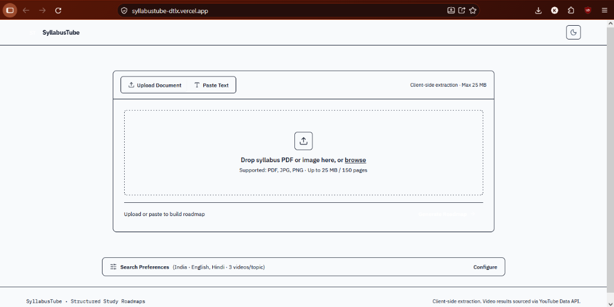
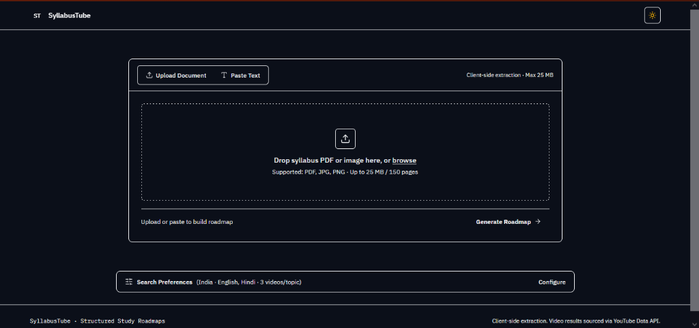
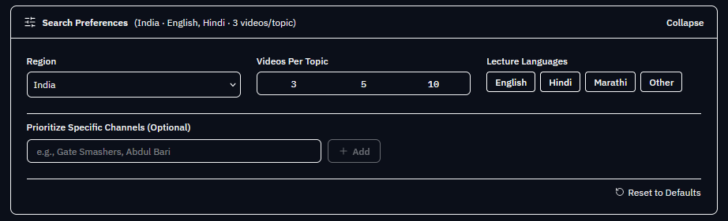

# SyllabusTube

Turn university syllabus documents into unit-by-unit YouTube study roadmaps.

## Screenshots

### Light Mode


### Dark Mode


### Search & Ranking Preferences


## Features

- **Document Extraction**: Client-side PDF text extraction via PDF.js and OCR via Tesseract.js in a Web Worker (only scans pages lacking text layers).
- **Large Document Processing**: Supports documents up to 25 MB and 150 pages, with sequential chunking, exponential backoff retries, and progressive unit rendering.
- **AI Syllabus Structuring**: Extracts courses, units, topics, and subtopics into structured data while isolating untrusted input against prompt injection.
- **YouTube Recommendations**: Searches curated educational video lectures per topic with custom preference filters (regions, languages, preferred channels).
- **Lazy Quota Loading**: YouTube searches are loaded unit-by-unit on demand to preserve API quota.
- **Study Progress Tracking**: Check off watched lectures with progress persisted per syllabus in localStorage.
- **Dark & Light Themes**: Class-based theme toggle with system preference detection and zero-flash inline loading.
- **Hardened Security**: Serverless reverse proxy with rate limiting, payload validation, CORS allowlist, and shared secret authentication to protect backend keys.

## How It Works

```
+--------------------+        +---------------------+        +--------------------+
|  Client (Browser)  |  --->  |   Serverless Proxy  |  --->  | Google Apps Script |
|                    |        |  (Vercel / Netlify) |        |      (Code.gs)     |
| - PDF.js / OCR     |        | - Rate Limiter      |        | - Gemini AI Model  |
| - Text Chunking    |        | - CORS Allowlist    |        | - YouTube Data API |
| - State Management |        | - Shared Secret     |        | - Script Secrets   |
+--------------------+        +---------------------+        +--------------------+
```

## Tech Stack

| Layer | Technologies |
|---|---|
| Frontend Framework | React 18 / 19, TypeScript, Vite |
| Styling & Typography | Tailwind CSS v4, IBM Plex Sans, IBM Plex Mono (@fontsource) |
| Icons | Lucide React |
| Client-side Extraction | PDF.js (pdfjs-dist), Tesseract.js (Web Worker OCR) |
| Proxy Layer | Vercel Serverless Function / Netlify Function |
| Backend & APIs | Google Apps Script (Code.gs), Google Gemini API, YouTube Data API v3 |

## Local Setup

1. **Clone the repository:**
   ```bash
   git clone https://github.com/Shravan007-op/syllabustube.git
   cd syllabustube
   ```

2. **Install dependencies:**
   ```bash
   npm install
   ```

3. **Configure environment:**
   Copy `.env.example` to `.env` and fill in your Apps Script URL:
   ```bash
   cp .env.example .env
   ```

4. **Start development server:**
   ```bash
   npm run build
   npm run preview
   ```
   Open `http://localhost:4173` in your browser.

## Required Environment Variables & Script Properties

### Frontend / Serverless Proxy Environment Variables
| Variable Name | Purpose |
|---|---|
| `VITE_APPS_SCRIPT_URL` | Deployed Google Apps Script `/exec` URL |
| `PROXY_SECRET` | Shared authentication secret sent to Apps Script (optional but recommended) |
| `ALLOWED_ORIGIN` | Allowed CORS origins for reverse proxy requests (optional) |
| `VITE_PORT` | Local preview/dev server port |

### Apps Script Properties (Project Settings > Script Properties)
| Property Name | Purpose |
|---|---|
| `GEMINI_API_KEY` | Primary Google Gemini API key |
| `GEMINI_API_KEY_BACKUP` | Backup Gemini API key for automatic failover (optional) |
| `YOUTUBE_API_KEY` | YouTube Data API v3 key |
| `GEMINI_MODEL` | Custom Gemini model name (default: `gemini-3.5-flash-lite`) |
| `PROXY_SECRET` | Must match `PROXY_SECRET` from proxy env to reject unauthorized callers |

## Deployment Steps

### 1. Google Apps Script Backend
1. Go to [Google Apps Script](https://script.google.com/) and create a new project.
2. Replace `Code.gs` contents with the code from `apps-script/Code.gs`.
3. Open **Project Settings** > **Script Properties** and add:
   - `GEMINI_API_KEY`
   - `YOUTUBE_API_KEY`
   - `PROXY_SECRET` (generate a secure random string)
4. Click **Deploy** > **New Deployment**:
   - Type: **Web App**
   - Execute as: **Me**
   - Who has access: **Anyone**
5. Copy the deployment URL ending in `/exec`.

### 2. Vercel Deployment
1. Connect your GitHub repository to Vercel.
2. In Project Settings > **Environment Variables**, set:
   - `VITE_APPS_SCRIPT_URL`: your Apps Script `/exec` URL
   - `PROXY_SECRET`: matching the secret set in Script Properties
   - `ALLOWED_ORIGIN`: your production Vercel domain
3. Deploy. The serverless proxy at `/api/proxy` handles incoming requests.

### 3. Netlify Deployment (Alternative)
1. Link your repository in the Netlify dashboard.
2. Under Site Configuration > **Environment Variables**, set `VITE_APPS_SCRIPT_URL` and `PROXY_SECRET`.
3. Deploy. The function at `/.netlify/functions/api` handles proxying.

## Security Notes

- No API keys or backend credentials exist in the client bundle, source maps, or git history.
- Production sourcemaps are disabled (`sourcemap: false`).
- Proxies validate HTTP methods (POST and OPTIONS only), enforce payload size limits (2 MB), restrict CORS origins, and throttle excessive client IP requests.
- Untrusted syllabus text is isolated inside `<UNTRUSTED_SYLLABUS_DATA>` delimiters with tag sanitization to prevent prompt injection.
- Generic error messages are presented to users; internal traces and credentials are never surfaced.

## Known Limits

- **File Size**: 25 MB document upload cap.
- **Page Cap**: Maximum 150 pages per PDF document to prevent browser memory exhaustion.
- **YouTube Quota**: Free YouTube Data API v3 keys provide 10,000 units/day. Video searches are lazy-loaded per unit to minimize usage.

## License

MIT License
